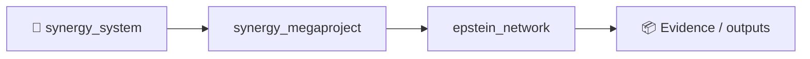

# Epstein Network — Distilled Master Graph

A provenance-first pipeline for distilling multiple public Epstein-related datasets into one deduplicated research graph.

## What this repository does

It synchronizes a curated registry of public GitHub sources and normalizes them into a common graph. The current source registry covers Black Book/contact data, flight logs, email communication graphs, document/entity corpora, co-occurrence graphs, timelines and provenance-oriented relationship datasets.

The target schema includes Person, EmailAddress, PhoneNumber, Organization, Address, Location, Flight, Airport, Document, Event, Claim and Citation nodes.

Important: inclusion in a contact book, email corpus, flight log, document or co-mention graph does **not** by itself imply wrongdoing. The project preserves edge semantics and provenance so that a direct communication edge is not confused with a co-mention or shared flight.

## Current source registry

The authoritative list is in `sources/sources.yaml`. It currently includes, among others:

- dleerdefi/epstein-network-data
- rhowardstone/Epstein-research-data
- minzique/jmail-explorer
- awhite121/jmail-network-explorer
- Bunka-lab/epstein-files
- cappy-dev/jmail-client
- phelix001/epstein-network
- maxandrews/Epstein-doc-explorer
- Pinperepette/parrhesepstein
- Donnadieu/Epstein-File-Explorer
- Kevinchamplin/epsteinsuite
- LMSBAND/epstein-files-db
- maninka123/Epstein-files-dashboard
- ronit111/epstein-files
- Ringmast4r/Epstein
- DanHouseman/epstein-files-analysis
- sen-do/dataviz
- rbd313/Epstein_Graph_30_Jan_2026
- SvetimFM/epstein-files-visualizations
- epstein-docs/epstein-docs.github.io
- markramm/EpsteinFiles
- paulgp/epstein-document-search
- sanashii/network-graph-epstein-files
- KrisX03/epstein-network-analysis
- Papotewii/EpsteIn

Mirrors/forks should be marked non-canonical rather than counted twice.

## Build

```bash
python -m venv .venv
source .venv/bin/activate
pip install -e .

python scripts/sync_sources.py
python -m epstein_network.build --vendor vendor --out data/processed
```

The scanner currently understands CSV, JSON, JSONL and SQLite databases. Additional source-specific adapters can be added without changing the master schema.

Generated outputs:

```
data/processed/nodes.csv
data/processed/edges.csv
data/processed/evidence.jsonl
data/processed/stats.json
```

## Historical email handling

Addresses observed in public archival material are stored with `status=historical_or_unknown`. Presence in an archive is not treated as proof that the mailbox is active in 2026. This project does not perform intrusive mailbox probing or account enumeration.

## Neo4j

```bash
docker compose up -d neo4j
```

Then import the generated CSV files using `neo4j/import.cypher`.

## Provenance

Every non-derived edge should retain:

- source repository
- source file
- source row/record
- confidence
- relationship semantics

The objective is a graph that can always answer: **“Why does this edge exist, and where did it come from?”**

## Research integrity

See `docs/SCHEMA.md` and `docs/DATA_POLICY.md`.


<!-- SYNERGY-FEDERATION-PASSPORT:START -->
---

## 🧭 SYNERGY federation passport

**Домен:** 🔬 Knowledge-graph research  
**Архитектурный родитель:** [`synergy_megaproject`](https://github.com/Shtenco/synergy_megaproject)  
**Архитектурный корень:** [`synergy_system`](https://github.com/Shtenco/synergy_system)



Архитектурная стрелка — это карта федерации, а не автоматически подтверждённая runtime dependency.

### Единый стандарт

Каждый проект должен документировать реальную проблему, реализацию, тесты, evidence, ограничения, file map, воспроизводимость, roadmap и границы утверждений. Это тот же принцип, который используется в `dlp_solver`.

### Навигация

- [📚 Атлас всех 75 репозиториев](https://github.com/Shtenco/synergy_system/blob/main/docs/SYNERGY_REPOSITORY_ATLAS.md)
- [🧾 Машиночитаемый registry](https://github.com/Shtenco/synergy_system/blob/main/registry/SYNERGY_REPOSITORIES.json)
- [🧭 SYNERGY SYSTEM](https://github.com/Shtenco/synergy_system)

### Evidence rule

`GREEN` означает только воспроизводимо подтверждённый тезис. Гипотеза, benchmark без корректного протокола, архитектурная диаграмма или красивый экономический цикл сами по себе GREEN не дают.

<!-- SYNERGY-FEDERATION-PASSPORT:END -->