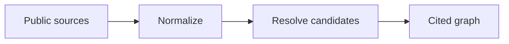

# Epstein Network — Provenance Graph — научно-техническое досье V5

**Ревизия:** 24.10.2026 · **Партия:** репозитории SYNERGY №68–82 · **Фактический статус:** RESEARCH: импорт/нормализация есть; доказанность конкретных связей определяется источником.

> Исходники и наличие тестов проверены по дереву `main`. Это **документационный аудит**, не свидетельство свежего CI, успешного деплоя, воспроизводимого benchmark или экономической прибыли. Старый README сохранён.

## 1. Научная постановка

Строить воспроизводимый граф из публичных материалов, отдельно сохраняя прямые контакты, совместные упоминания, документальные связи и происхождение каждого утверждения.

## 2. Реализация и исследовательская новизна

Нормализация CSV/JSON/JSONL/SQLite, детерминированные ID, объединение точных token-key; fuzzy similarity `SequenceMatcher` с порогом ≥0.94 и одинаковыми инициалами попадает в кандидаты ручной проверки, а не автоматически подтверждает тождество.

## 3. Математическая формализация

\[s(a,b)=\operatorname{SequenceMatcherRatio}(\operatorname{norm}(a),\operatorname{norm}(b)),\quad s\ge0.94\ \text{is review-only}.\]

Разграничение: формула, реализованная в исходном коде, может быть перепроверена статически; численные результаты и перенос на реальные данные требуют отдельного исполнения с артефактами и независимыми baseline.

## 4. Операционная цепочка



`architecture` описывает поток данных и проектное назначение; автоматически подтверждённой federated runtime-связи отсюда не следует.

## 5. Навигация по проверенным артефактам

- [`sources/sources.yaml`](../sources/sources.yaml)
- [`src/epstein_network/entity_resolution.py`](../src/epstein_network/entity_resolution.py)
- [`src/epstein_network/build.py`](../src/epstein_network/build.py)
- [`docs/SCHEMA.md`](../docs/SCHEMA.md)
- [`docs/DATA_POLICY.md`](../docs/DATA_POLICY.md)
- [`tests/test_normalize.py`](../tests/test_normalize.py)

## 6. Воспроизведение: доступная команда

```bash
python -m pip install -e .
python -m pytest -q
# Для импорта данных отдельно: см. README и политику источников
```

Команды приведены как **инструкция для самостоятельного запуска**, они не означают, что тесты были выполнены в рамках данной документационной ревизии.

## 7. Проверяемые гипотезы и acceptance gates

Стабильность идентификаторов; запрет смешения `mentioned_in`, `direct_communication`, `co_flight`; source-level deduplication; regression на неверное слияние однофамильцев; сохранение исходного evidence.

**Граница доказательности:** `SOURCE_PRESENT` и `TEST_SOURCE_PRESENT` отличаются от `TEST_EXECUTED`, `INTEGRATION_VERIFIED`, `DEPLOYED` и `PRODUCTION_READY`. Для повышения статуса нужны command, environment, commit SHA, input manifest, raw output и критерий проверки.

## 8. Угрозы и отказоустойчивость

Ложные личности, дубли форков, неполная атрибуция, неправомерное распространение персональных данных, контекстуальное искажение графа.

## 9. Не доказано / ограничения

Наличие человека в публичном списке контактов, перелётов или переписке само по себе не доказывает преступления или участие в противоправной деятельности. Исторический email не подтверждает активность адреса.

## 10. Следующий инженерный рубеж

Review queue для всех неоднозначных объединений, цитирование конкретного документа/страницы, confidence calibration и независимая проверка ошибочных рёбер.

## 11. Стандарт оформления и история

Досье ориентируется на практику [REVERSE-EXP](https://github.com/Shtenco/dlp_solver) и [SYNERGY SYSTEM](https://github.com/Shtenco/synergy_system): проверяемая постановка, формулы, ссылки на настоящий код, fidelity к реальному зрелости проекта и явные фальсифицирующие тесты. Исходный README и Git-история не удаляются. Четыре охраняемых README экосистемы остаются вне этой партии.
